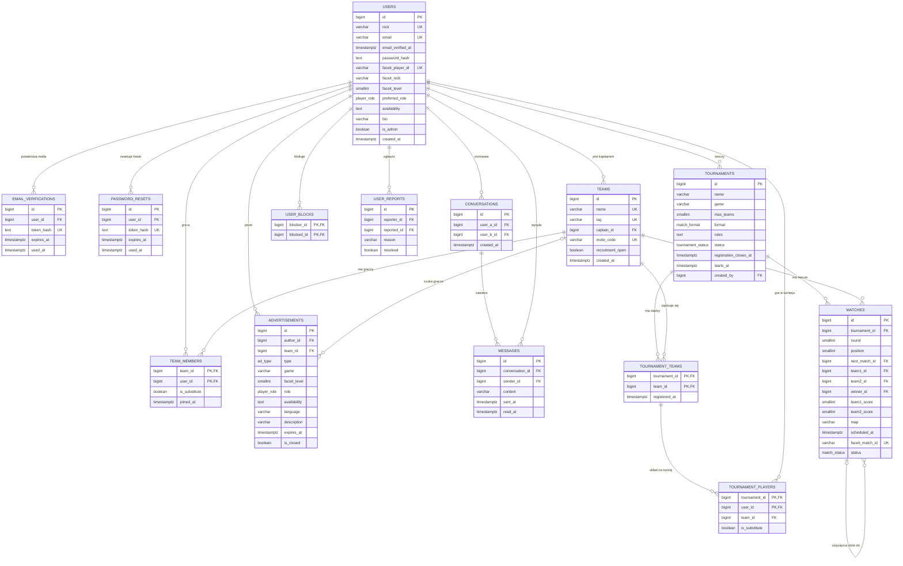

# Baza danych

Baza to PostgreSQL. Są tu dwa pliki:

| Plik | Co robi |
| --- | --- |
| `schema.sql` | tworzy wszystkie tabele i zasady, których baza pilnuje sama |
| `seed.sql` | wrzuca przykładowe dane: 44 graczy, 8 drużyn, 4 turnieje (w tym jeden zakończony z pełną drabinką), ogłoszenia i rozmowę na czacie |

Hasło do każdego testowego konta to `haslo123`. Logować się można nickiem albo mailem, maile są w stylu `bartek@example.com`.

## Diagram



## Co pilnuje sama baza

| Zasada z wymagań | Jak |
| --- | --- |
| Nick jest unikalny, wielkość liter nie ma znaczenia (BR-001) | unikalny indeks na `LOWER(nick)` |
| Jeden e-mail to jedno konto, wielkość liter nie ma znaczenia | unikalny indeks na `LOWER(email)` |
| E-mail ma poprawny format | `CHECK` z wyrażeniem regularnym na `email` |
| Link aktywacyjny z maila działa 24 godziny i tylko raz | `expires_at` i `used_at` w `email_verifications` |
| Link do resetu hasła działa godzinę i tylko raz | `expires_at` domyślnie `NOW() + 1 godzina`, `used_at` w `password_resets` |
| Poziom FACEIT od 1 do 10 (BR-006) | `CHECK` na `faceit_level` |
| Tag drużyny ma 3 lub 4 znaki (BR-007) | `CHECK` na `tag` |
| Kod zaproszenia jest unikalny (BR-008) | `UNIQUE` na `invite_code` |
| Ogłoszenie wygasa po 7 dniach (BR-016) | `expires_at` domyślnie `NOW() + 7 dni` |
| Ogłoszenie typu LFM zawsze ma drużynę (BR-013) | `CHECK` na `type` i `team_id` |
| Turniej ma 8 albo 16 miejsc (BR-023) | `CHECK` na `max_teams` |
| Gracz gra w turnieju tylko w jednej drużynie (BR-012) | klucz główny `(tournament_id, user_id)` w `tournament_players` |
| Ten sam link FACEIT nie przejdzie dwa razy (BR-033) | `UNIQUE` na `faceit_match_id` |
| Mecz nie kończy się remisem (RB-003) | `CHECK` na wyniku |
| Zwycięzca to jedna z dwóch drużyn meczu | `CHECK` na `winner_id` |

Rzeczy typu „maksymalnie 5 + 2 graczy” albo „tylko kapitan może zapisać drużynę” sprawdzi backend.

## Jak odpalić

**Bez instalowania niczego:** wejdź na [db-fiddle.com](https://www.db-fiddle.com), wybierz PostgreSQL 15, w lewe okno wklej `schema.sql` i pod nim `seed.sql`, a w prawe jedno z zapytań poniżej. Kliknij Run.

**Z Dockerem:** skopiuj `.env.example` jako `.env` i w głównym folderze repo wpisz:

```
docker compose up -d
```

Baza wstanie tylko na `127.0.0.1:5432` razem z przykładowymi danymi. To konfiguracja lokalna.

Na R740 użyj osobnego pliku `docker-compose.production.yml` zgodnie z [DEPLOYMENT.md](../DEPLOYMENT.md). Produkcyjna baza nie wystawia portu na hoście i ma osobny wolumen `production_db_data`. Wczytuje `schema.sql` bez `seed.sql`, więc nie zakłada testowych kont. `init-app-role.sh` tworzy konto `cgp_app` z dostępem do tabel i sekwencji, bez uprawnień właściciela bazy, tworzenia obiektów i uruchamiania programów systemowych przez rolę superużytkownika. Przy zmianie schematu właściciel musi nadać odpowiednie uprawnienia do nowych tabel i sekwencji.

## Przykładowe zapytania

### Kto szuka drużyny jako entry z poziomem 6 lub wyżej

```sql
SELECT u.nick, a.faceit_level, a.availability, a.description
FROM advertisements a
JOIN users u ON u.id = a.author_id
WHERE a.type = 'lfc' AND a.role = 'entry' AND a.faceit_level >= 6
  AND a.is_closed = FALSE AND a.expires_at > NOW();
```

| nick | faceit_level | availability | description |
| --- | --- | --- | --- |
| Kuba | 7 | wieczory po 19, weekendy | Szukam ekipy na turnieje, gram entry. Mam mikrofon i ogarniam callouty. |

### Rozmowa kapitana z graczem z ogłoszenia

```sql
SELECT u.nick AS kto, m.content AS wiadomosc
FROM messages m
JOIN users u ON u.id = m.sender_id
ORDER BY m.sent_at;
```

| kto | wiadomosc |
| --- | --- |
| Tomek | Siema, widziałem Twoje ogłoszenie. Szukamy entry na Puchar Akademika, wchodzisz? |
| Kuba | Hej, pewnie. Kiedy gracie? |
| Tomek | Zwykle wieczorami po 19. Masz kod do drużyny: PLS5X8 |
| Kuba | Dzięki, zaraz wpisuję |

### Ile nieprzeczytanych wiadomości ma Tomek

```sql
SELECT other.nick AS z_kim,
       COUNT(m.id) FILTER (WHERE m.read_at IS NULL AND m.sender_id <> me.id) AS nieprzeczytane
FROM users me
JOIN conversations c ON me.id IN (c.user_a_id, c.user_b_id)
JOIN users other ON other.id IN (c.user_a_id, c.user_b_id) AND other.id <> me.id
LEFT JOIN messages m ON m.conversation_id = c.id
WHERE me.nick = 'Tomek'
GROUP BY other.nick;
```

| z_kim | nieprzeczytane |
| --- | --- |
| Kuba | 1 |

### Skład drużyny

```sql
SELECT u.nick, u.preferred_role, u.faceit_level,
       CASE WHEN tm.is_substitute THEN 'rezerwa' ELSE 'podstawa' END AS miejsce,
       t.captain_id = u.id AS kapitan
FROM team_members tm
JOIN teams t ON t.id = tm.team_id
JOIN users u ON u.id = tm.user_id
WHERE t.tag = 'AKD'
ORDER BY tm.is_substitute, u.nick;
```

| nick | preferred_role | faceit_level | miejsce | kapitan |
| --- | --- | --- | --- | --- |
| Bartek | igl | 8 | podstawa | true |
| Michał | flex | 7 | podstawa | false |
| Paweł | support | 6 | podstawa | false |
| Wiktor | awp | 9 | podstawa | false |
| Łukasz | entry | 7 | podstawa | false |
| Grzesiek | flex | 6 | rezerwa | false |

### Wolne miejsca w turniejach

```sql
SELECT tr.name, tr.max_teams, COUNT(tt.team_id) AS zapisane,
       tr.max_teams - COUNT(tt.team_id) AS wolne_miejsca
FROM tournaments tr
LEFT JOIN tournament_teams tt ON tt.tournament_id = tr.id
GROUP BY tr.id
ORDER BY tr.starts_at;
```

| name | max_teams | zapisane | wolne_miejsca |
| --- | --- | --- | --- |
| Turniej Otwarcia | 8 | 8 | 0 |
| Puchar Akademika #1 | 8 | 4 | 4 |
| Sesja Cup | 8 | 5 | 3 |
| Nocny Turniej BO3 | 16 | 1 | 15 |

### Drabinka turnieju

```sql
SELECT m.round AS runda, m.position AS mecz,
       t1.name AS druzyna_1, t2.name AS druzyna_2,
       m.team1_score || ':' || m.team2_score AS wynik, m.status
FROM matches m
JOIN tournaments tr ON tr.id = m.tournament_id
LEFT JOIN teams t1 ON t1.id = m.team1_id
LEFT JOIN teams t2 ON t2.id = m.team2_id
WHERE tr.name = 'Puchar Akademika #1'
ORDER BY m.round, m.position;
```

| runda | mecz | druzyna_1 | druzyna_2 | wynik | status |
| --- | --- | --- | --- | --- | --- |
| 1 | 1 | Ekipa z Akademika | Cebulowe Smoki | 13:8 | finished |
| 1 | 2 | Nocne Marki | Sigma Squad | | awaiting_result |
| 2 | 1 | Ekipa z Akademika | | | scheduled |

### Próba wklejenia tego samego linku FACEIT drugi raz

```sql
INSERT INTO matches (tournament_id, round, position, faceit_match_id)
SELECT id, 1, 3, '1-8f3c2a71-4b6e-4d2a-9c11-2e7f5d9a0b43'
FROM tournaments WHERE name = 'Puchar Akademika #1';
```

Baza odrzuca to błędem `duplicate key value violates unique constraint "matches_faceit_match_id_key"`.
