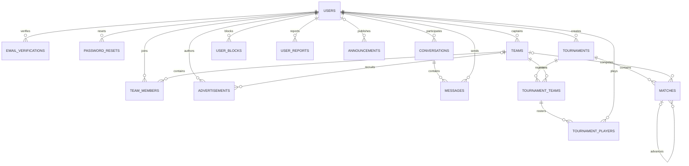

# Prototype database

The preserved prototype uses PostgreSQL 17. These files document the previous application and remain under `prototype/` for reference. The [new CGP application](../../docs/REBUILD.md) will use SQLite on Cloudflare and needs its own schema and migrations.

## Files and responsibilities

| File | Purpose |
| --- | --- |
| [`schema.sql`](schema.sql) | Creates types, tables, constraints, and indexes in a fresh database. |
| [`seed.sql`](seed.sql) | Adds local sample users, teams, tournaments, ads, and chat data. |
| [`upgrade.sql`](upgrade.sql) | Updates an existing database while preserving data and administrator grants. Grants an existing `cgp_app` role access to added tables and sequences. |
| [`init-app-role.sh`](init-app-role.sh) | Creates the restricted application role during fresh production-mode Docker initialization. |

The local Compose file initializes a new volume with the schema and demo data. The production-mode Compose file initializes a new volume with the schema and restricted role, without demo data or default accounts. Existing volumes are never upgraded by these initialization mounts.

## Schema overview

| Tables | Stored data |
| --- | --- |
| `users` | Accounts, password hashes, email verification state, player profile fields, bans, and administrator flag. |
| `email_verifications`, `password_resets` | Hashed one-time tokens, expiry, and consumption state. |
| `teams`, `team_members` | Team details, captain, invite code, and membership. |
| `advertisements` | Player/team recruitment ads, filters, expiry, and closure state. |
| `conversations`, `messages` | One-to-one conversation membership, messages, and read timestamps. |
| `user_blocks`, `user_reports` | User blocking and moderation reports. |
| `announcements` | Administrator-created site banners. |
| `tournaments`, `tournament_teams`, `tournament_players` | Tournament metadata, registrations, and player rosters. |
| `matches` | Bracket positions, participating teams, scores, next match, and external match identifier. |

Some structures support workflows without implemented API endpoints. In particular, team creation/invitations, profile editing, tournament creation/registration, and real FACEIT result import are incomplete. Refer to the [prototype README](../README.md) rather than inferring a workflow from a table.



## Constraints and application checks

The database enforces case-insensitive unique nicknames and emails, email shape, optional FACEIT levels from 1 to 10, team tags of 3 or 4 characters, unique invite codes, valid recruitment-ad/team combinations, and unique ordered conversation pairs.

Tournament sizes are restricted to 8 or 16 teams. A player can represent one team in a tournament. Match positions and external match identifiers are unique within their defined constraints, a winner must be a participant, and populated scores cannot be equal. See [`schema.sql`](schema.sql) for the full definitions.

Verification and recovery expiry timestamps default to 24 hours and 1 hour respectively. Ad expiry defaults to 7 days. The application checks token expiry/consumption, authorization, active-ad quotas, and which rows may be read or changed. A timestamp or constraint alone does not implement the corresponding workflow.

## Run locally

From `prototype/`, copy `.env.example` to `.env` and set the local database password consistently in `POSTGRES_PASSWORD` and `DATABASE_URL`. Then start the disposable local database:

```sh
docker compose up -d db
```

The database is published at loopback port 5432. On a new volume, Docker loads the schema and sample data. Existing volumes retain their data and require a manual upgrade when the schema changes.

Seeded local accounts use `haslo123`, with emails such as `bartek@example.com`. The demo administrator is `Admin`. These accounts are local-only and are not part of production-mode initialization.

The optional backend fallback can load schema and demo data only into an empty database outside production with `AUTO_INIT_DATABASE=true`. The presence of `users` does not prove that every migration is applied. Production rejects automatic demo initialization.

`npm run db:reset` from `prototype/backend/` deletes the schema and reloads demo data. It refuses to run in production. Use it only for a disposable local database, never to upgrade or recover persistent data.

## Upgrading an existing database

Follow the [Docker upgrade procedure](../DEPLOYMENT.md#upgrading-an-existing-database). Test the release and migration against a restored copy, stop the app, take a final backup, and verify restoration in a separate database before upgrading.

For an owner-configured `psql` client, run from `prototype/`:

```sh
psql -v ON_ERROR_STOP=1 --single-transaction --file=database/upgrade.sql
```

Check the target database and role first. Leave the app stopped after an error until the cause is resolved and the upgrade succeeds. Do not reload schema or seed files, use `db:reset`, or remove the volume to upgrade an existing database.

The upgrade is safe to repeat and preserves data and existing administrator permissions. If `cgp_app` exists, it receives data access to the added chat, block, report, and announcement tables and their ID sequences. The upgrade does not create the role or grant it schema-changing privileges. It also works in a local owner-managed database without that role.

## Roles and administrators

The production-mode Docker configuration separates `cgp_owner` from `cgp_app`. The owner performs initialization and manual upgrades. The application uses only the restricted role for data and sequence access. Do not give the application the owner's credentials or run owner-only schema changes at application startup.

New accounts default to `is_admin = FALSE`, regardless of nickname. For a deployment you control, verify the account owner's identity and email, then grant administrator access to the explicit `users.id`. The nickname `Admin` never grants production privileges.

If an earlier upgrade granted administrator rights based on a nickname, review existing administrator IDs and revoke unintended grants explicitly. The corrected upgrade preserves existing grants rather than deciding which accounts are authorized.

## Example read queries

Run these only against a database you control. The examples use the prototype schema and synthetic local data.

```sql
SELECT t.name, u.nick AS captain, COUNT(tm.user_id) AS members
FROM teams t
JOIN users u ON u.id = t.captain_id
LEFT JOIN team_members tm ON tm.team_id = t.id
GROUP BY t.id, u.nick
ORDER BY t.name;
```

```sql
SELECT tr.name, tr.max_teams, COUNT(tt.team_id) AS registered,
       tr.max_teams - COUNT(tt.team_id) AS available
FROM tournaments tr
LEFT JOIN tournament_teams tt ON tt.tournament_id = tr.id
GROUP BY tr.id
ORDER BY tr.starts_at;
```

## Validation

Database changes require fresh initialization and an existing-database upgrade in a separate local environment. Verify repeatability, preserved records and administrator grants, and restricted-role data access. Application tests use mocks and do not verify SQL migrations or backup restoration.
